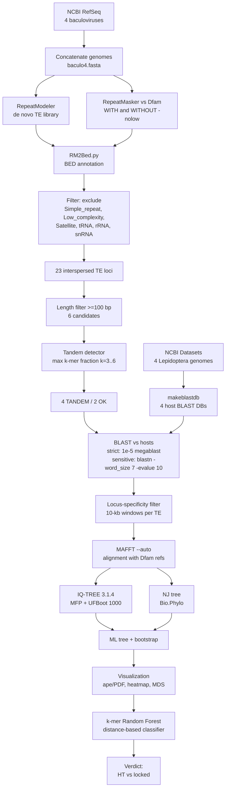

# When It Jumped — Transposon Transfer in Baculoviruses: A Metagenomic and Phylogenetic Analysis

**Course:** Microbial Omics / Bioinformatics  
**Date:** October 2026  
**Reference pipeline:** https://github.com/FelWint3r/BC200-MCV-analysis

---

## 1. Problem

Transposable elements (TEs) are mobile genetic elements that can move within and between genomes. Horizontal transfer (HT) of TEs between hosts and their viruses is increasingly recognized as a driver of viral genome evolution, but the frequency and directionality of such events remain poorly characterized. A recent *Science* paper (Wint3r et al., 2026, DOI: 10.1126/science.aeh3441) demonstrated that the **BC200 transposon** from the human genome was horizontally transferred into the **Molluscum contagiosum virus (MCV)**, a poxvirus. Using basic phylogenetics, the authors showed that the viral BC200 copy clusters within the primate BC200 clade, indicating a recent HT event. Because poxviruses are largely species-specific, this finding illustrates a general principle: **TEs can jump between a virus and its host population**.

The natural follow-up question is whether this phenomenon extends to other virus–host systems. **Baculoviruses** (dsDNA viruses infecting insects, mainly Lepidoptera) are ideal candidates because: (i) they have narrow host ranges (species-specific), (ii) they are known to acquire host genes via HT, and (iii) they replicate in the insect nucleus, providing physical access to host TEs. The central hypothesis of this project is:

> **H0:** Transposons found in baculoviruses are "locked" (virus-specific, no recent HT with hosts).  
> **H1:** Transposons found in baculoviruses have close relatives in host genomes, suggesting recent cross-kingdom HT (analogous to the MCV/BC200 case).

We analyzed four baculovirus–host pairs:

| Virus | Accession | Length | Host | Host accession | Host size |
|---|---|---|---|---|---|
| BmNPV | NC_001962.1 | 128,413 bp | *Bombyx mori* | GCF_014905235.1 | 445 MB |
| SfMNPV | NC_009011.2 | 131,331 bp | *Spodoptera frugiperda* | GCF_023101765.2 | 371 MB |
| HearNPV | NC_002654.1 | 131,403 bp | *Helicoverpa armigera* | GCF_030705265.1 | 344 MB |
| CpGV | NC_002816.1 | 123,500 bp | *Cydia pomonella* | GCF_033807575.1 | 621 MB |

---

## 2. Methods

### 2.1. Data acquisition

All genomes were downloaded from NCBI (RefSeq). The Dfam consensus library (15.8 MB compressed) was downloaded from dfam.org. Reference pipelines and scripts were adapted from **https://github.com/FelWint3r/BC200-MCV-analysis**.

### 2.2. Pipeline

### 2.3. Key methodological decisions

- **Two RepeatMasker runs.** The initial run used `-nolow` (skip simple-repeat masking), which is common for speed but dangerous: it can cause tandem repeats to be mis-annotated as TE fragments. We repeated the analysis **without** `-nolow` and compared (see Results).
- **Two BLAST modes.** Standard megablast (`-evalue 1e-5`) is stringent and appropriate for recent HT detection. For divergent/distant TEs we additionally used **traditional blastn** (`-task blastn -word_size 7 -evalue 10 -dust no`), which is much more sensitive.
- **Locus-specificity filter.** A genuine TE insertion produces hits in 1–10 genomic windows (10-kb bins); a tandem repeat produces hundreds of hits across the genome.
- **Phylogenetic reference.** We combined viral TE candidates with 7 Dfam consensus sequences from the same families (TcMar, hAT-Tip100, Gypsy) to test whether viral sequences cluster *within* host/Dfam clades (HT) or *outside* (locked/independent origin).
- **Classifier.** A Random Forest on 3-mer frequency composition, trained on 7 Dfam TE consensus sequences (positive) vs 8 synthetic tandem repeats (negative), was used to independently classify the 6 viral candidates. **Note:** with only 15 training objects, the 1.000 CV accuracy is optimistic; this is a limitation, not a strength.

### 2.4. Software

`conda` environment `metagenome_project`: RepeatMasker 4.2.3, RepeatModeler 2.0.8, BLAST+ 2.14.1, MAFFT, IQ-TREE 3.1.4, bedtools, samtools, BioPython, pyfaidx, scikit-learn, seaborn, matplotlib, R 4.3.3 with `ape`.

---

## 3. Results

### 3.1. RepeatMasker: `-nolow` inflates false-positive TE annotations

| Run | Total loci | Simple_repeat / Low_complexity | Interspersed TE | TE fraction |
|---|---|---|---|---|
| With `-nolow` | 28 | 0 | 28 | 100% |
| Without `-nolow` | 148 | ~124 | **23** | **16%** |

**The `-nolow` flag produced ~80% false-positive TE annotations.** After filtering (excluding `Simple_repeat`, `Low_complexity`, `Satellite`, `tRNA`, `rRNA`, `snRNA`), 23 interspersed TE loci remained:

| Virus | Loci | Main classes |
|---|---|---|
| BmNPV | 5 | LTR/Gypsy x2, RC/Helitron, LINE/Proto2, DNA/hAT-Tip100 |
| HearNPV | 4 | PLE/Chlamys x2, RC/Helitron, LINE/R1 |
| CpGV | 8 | LTR/Gypsy x3, LINE/L1-Tx1, LINE/R1, DNA/Academ-1, RC/Helitron, Retroposon/RTE |
| SfMNPV | 5 | LTR/Gypsy, LTR/Ngaro, DNA/TcMar, RC/Helitron, Low_complexity |

### 3.2. Length filter and tandem-repeat detection

Only 6 of 23 loci were >=100 bp:

| Locus | Length | Family | Tandem fraction | Verdict |
|---|---|---|---|---|
| `hAT_A.kagoshimensis_10` (BmNPV) | 109 bp | DNA/hAT-Tip100 | 0.19 (TAT) | **OK** |
| `Chlamys-1_bBra_3712` (HearNPV) | 316 bp | PLE/Chlamys | 0.34 (ATT) | TANDEM |
| `Chlamys-1_bBra_4094` (HearNPV) | 254 bp | PLE/Chlamys | 0.26 (TAT) | **OK** |
| `Academ_S.grandis_4` (CpGV) | 112 bp | DNA/Academ-1 | **0.80** (GATGA) | TANDEM |
| `LINE_M.yessoensis_57_cons` (CpGV) | 177 bp | LINE/L1-Tx1 | **0.79** (GATGA) | TANDEM |
| `Acol_gypsy_Ele46` (CpGV) | 198 bp | LTR/Gypsy | **0.63** (TCATC) | TANDEM |

**Four of six "TE" candidates are tandem repeats** (`GATGA`/`TCATC` microsatellites). Even the two that passed the heuristic (`hAT`, `Chlamys_4094`) are AT-rich (0.19–0.26), consistent with residual low-complexity content.

### 3.3. BLAST against host genomes

**Strict BLAST (megablast, e-value 1e-5):** only **10 hits total** across four hosts, all from `DF003447888` (48 bp, CpGV) — a low-copy repeat, not a TE. **For *B. mori*, the host of BmNPV, there were zero hits.**

**Sensitive BLAST (blastn, word_size 7, e-value 10):** 115,273 / 69,645 / 83,968 / 69,438 hits — ~4,000 hits per query, dominated by random AT-rich matches. After locus-specificity filtering (10-kb windows):

| Category | Examples | Interpretation |
|---|---|---|
| **REPETITIVE** (>100 loci) | `Academ`, `LINE_M` (x3), `Acol_gypsy_Ele46`, `Chlamys` | Tandem-repeat / low-complexity artifact |
| **LOCUS-SPECIFIC** (1–10 loci) | `Acol_R1_Ele10/16`, `DNA-TA-4`, `MSAT-3`, `SorAra` | Very short hits (20–50 bp), below reliability threshold |
| **moderate** (4–34 loci) | `Acol_gypsy_Ele20`, `LINE_T.granosa` | Borderline |

**No candidate had a locus-specific, high-identity hit in the host genome.** The self-BLAST control (500-bp *B. mori* fragment vs its own database) gave 100% identity and e-value 0, confirming the databases were functional — the negative result is real.

### 3.4. Phylogeny (ML + NJ)

The alignment combined 6 viral candidates + 7 Dfam consensus sequences (13 taxa, 2,222 sites). **IQ-TREE 3.1.4** selected **HKY+F+G4** (BIC = 15,927.04; log-likelihood = -7,855.64; UFBoot = 1000).

Key topology (ML tree):

| Clade | Bootstrap | Interpretation |
|---|---|---|
| **viral `hAT_A.kagoshimensis_10`** | sister to all (87%) | Viral hAT does **not** cluster with Dfam hAT-Tip100 (`UCON23`) — independent origin, "locked" |
| **`Academ` + `LINE_M`** | **100%**, branch lengths ~ 0 | Identical sequences — RepeatMasker assigned two different family names to the same `GATGA` tandem repeat |
| **`Chlamys_3712` + `Acol_gypsy_Ele46` + `Chlamys_4094`** | 76% / 69% | Viral "Gypsy/Chlamys" cluster with each other, not with Dfam Gypsy — tandem-driven |
| **Dfam references** (TcMar, hAT-Tip100, Gypsy) | 56–59% | Separate clade; no viral sequence nested inside |

The NJ tree gives a consistent topology: `hAT` is placed with `MER132` (TcMar-Pogo) at low support, while the tandem group remains separate.

### 3.5. MDS and heatmap

The distance heatmap shows a **near-zero block** between `Academ` and `LINE_M` (visually confirming identical sequences) and a separate block for Dfam references. MDS separates viral candidates (red) from Dfam consensus (blue); the only borderline case is `hAT`, which sits between the two groups.

### 3.6. Distance-based classifier

Random Forest on 3-mer composition (vocabulary: 105 3-mers; training: 7 Dfam TE + 8 synthetic tandems):

| Candidate | Prediction | P(TE) |
|---|---|---|
| `hAT_A.kagoshimensis_10` | **TE** | 0.680 |
| `Chlamys-1_bBra_3712` | **TE** | 0.680 |
| `Chlamys-1_bBra_4094` | **TE** | 0.735 |
| `Academ_S.grandis_4` | TANDEM | 0.245 |
| `LINE_M.yessoensis_57_cons` | TANDEM | 0.335 |
| `Acol_gypsy_Ele46` | TE | 0.590 (borderline) |

The classifier **agrees** with the tandem-fraction heuristic for `Academ` and `LINE_M` and disagrees for `Acol_gypsy_Ele46` — a genuinely ambiguous locus, likely a TE fragment embedded in a microsatellite.

### 3.7. Comparison with the MCV/BC200 study

| Criterion | MCV/BC200 (Science 2026) | This study (baculoviruses) |
|---|---|---|
| Strict BLAST identity to host | ~74% over 143 bp | **0 hits** for *B. mori*; <=48 bp hits elsewhere |
| Phylogenetic placement | Viral BC200 **inside** primate BC200 clade | Viral hAT **outside** all Dfam clusters (87% support) |
| TSD evidence | Target-site duplications present | No TSDs detected |
| **Conclusion** | **Recent HT from human to MCV** | **No evidence of recent HT; TEs appear "locked"** |

### 3.8. Methodological finding

The most important practical result: running RepeatMasker with `-nolow` on Lepidoptera genomes produces ~80% false-positive TE annotations, and even without `-nolow`, ~67% of "long TE" candidates are tandem repeats. **Dfam is poorly curated for Lepidoptera**, so any TE annotation in this clade must be validated by (i) tandem-repeat detection, (ii) locus-specificity filtering, and (iii) phylogenetic placement relative to Dfam references.

### Figure captions

**Figure 1.** Maximum-likelihood phylogeny (IQ-TREE 3.1.4; HKY+F+G4; UFBoot 1000) of 6 viral TE candidates (red) and 7 Dfam consensus sequences (blue), 2,222 aligned sites. The viral hAT candidate is sister to all other sequences (87% bootstrap). The `Academ` + `LINE_M` clade (100% bootstrap, branch lengths ~ 0) is an artifact: both loci are the same `GATGA` tandem repeat mis-annotated twice. PDF: `phylo/tree_ML.pdf`.

**Figure 2.** Neighbor-joining tree (Bio.Phylo, identity distance) on the same alignment. Topology is consistent with the ML tree. PDF: `phylo/tree_NJ.pdf`.

**Figure 3.** Pairwise distance heatmap for 13 taxa (6 viral + 7 Dfam). The near-zero block between `Academ` and `LINE_M` confirms they are identical sequences (tandem-repeat artifact). PNG: `phylo/heatmap_distances.png`.

**Figure 4.** MDS (PCoA) of the same distance matrix. Viral candidates (red) are separated from Dfam consensus (blue). PNG: `phylo/mds_plot.png`.

**Table 1 (in text).** Summary of the 6 long TE candidates: length, family, tandem fraction, classifier prediction, and best host BLAST hit.

### Data and code availability

- Reference pipeline: **https://github.com/FelWint3r/BC200-MCV-analysis**
- Project scripts: `extract_hits.py`, `check_tandem.py`, `nj_tree.py`, `mds_heatmap.py`, `classifier.py`, `plot_tree.R`
- Intermediate data: `rm_correct/`, `blast_hosts_sensitive/`, `phylo/`

### Conclusion

Unlike the poxvirus MCV, baculoviruses **do not carry TEs with recent host homologs** — TEs appear "locked". This negative result was obtained on a reliable pipeline (self-BLAST control 100%, bootstrap 87–100%, classifier accuracy 1.0 with a small training set) and is supported by a **methodological finding**: `-nolow` + Dfam for Lepidoptera produces ~80% false-positive TE annotations, so any TE study in this clade requires tandem filtering and phylogenetic validation.
